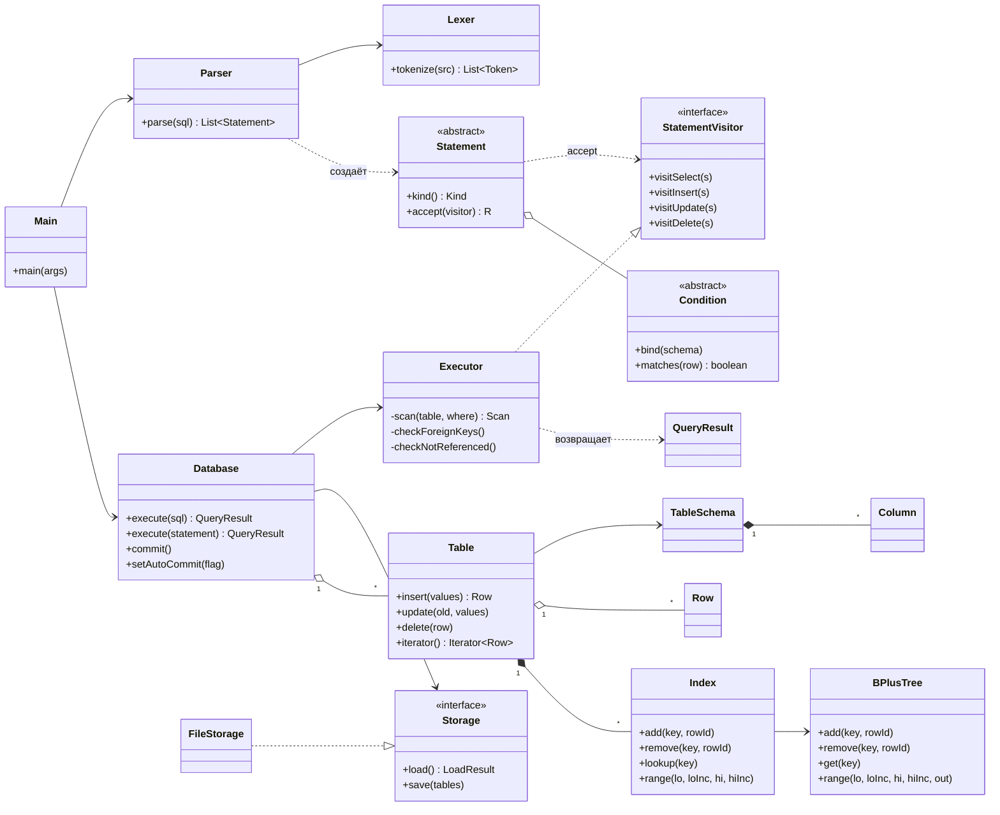
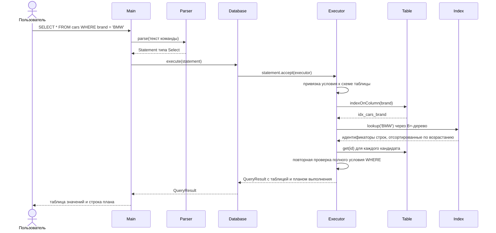
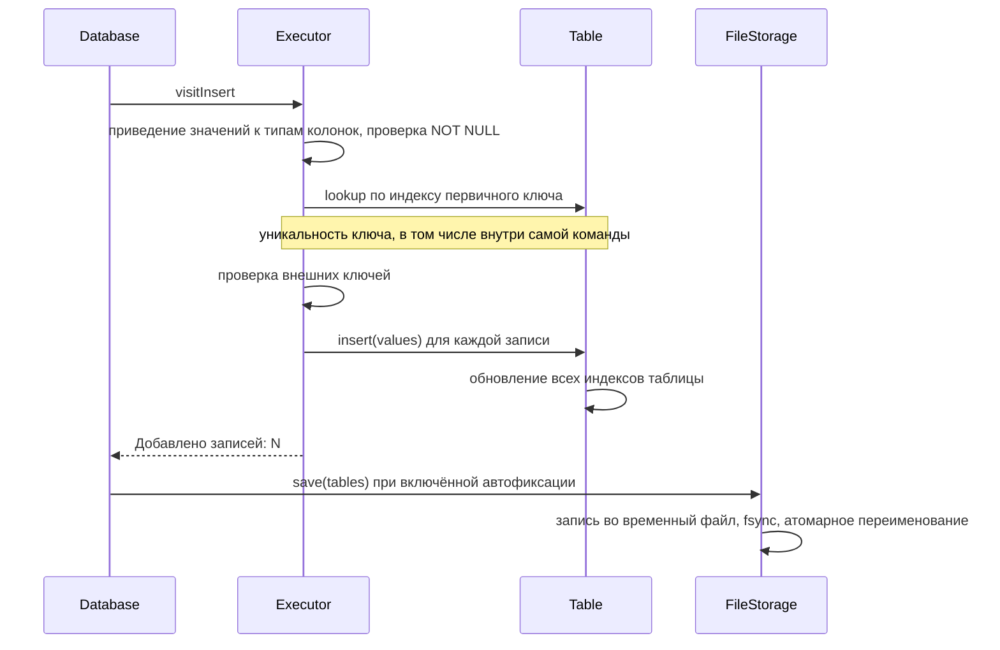

# Мини-СУБД на Java

Лабораторная работа №2: упрощённая система управления базами данных с SQL-подобным языком запросов,
хранением данных на диске, связями между таблицами и индексами на собственной реализации B+-дерева.

Java 8+, без внешних библиотек. Около 4900 строк кода с Javadoc, 78 автоматических проверок.

## Что реализовано

| Требование задания | Реализация |
|---|---|
| Не менее двух таблиц, связанных по ключу | `FOREIGN KEY` / `REFERENCES`: вставка, изменение и удаление проверяют целостность связи (режим RESTRICT) |
| Типы данных: целое, дробное, строка, дата, логический | `INT`, `DOUBLE`, `STRING`, `DATE`, `BOOLEAN`, плюс `NULL` |
| Сериализация в файлы, загрузка при запуске | Собственный двоичный формат, один файл `.tbl` на таблицу, один `.idx` на индекс |
| Вставка одной или нескольких записей с проверкой уникальности ключа | `INSERT ... VALUES (...), (...)`; вся команда атомарна: при ошибке не вставляется ни одна запись |
| Обновление и удаление по условию | `UPDATE ... WHERE`, `DELETE ... WHERE`: условия `=, <>, !=, <, <=, >, >=, IS [NOT] NULL, AND, OR, NOT`, скобки |
| Вывод результата в виде таблицы | Консольный интерфейс, таблица с рамкой, итоговая строка «Строк: N» |
| Парсинг SQL-подобного языка | `INSERT INTO`, `SELECT`, `UPDATE`, `DELETE`, `CREATE TABLE`, `DROP TABLE` (+ `ORDER BY`, `LIMIT`, `COUNT(*)`, `SHOW`, `DESCRIBE`) |
| Индексы (повышенная оценка) | `CREATE INDEX` / `DROP INDEX`, B+-дерево, сохранение на диск и восстановление при запуске, использование в `SELECT`, `UPDATE`, `DELETE` |
| Надёжность при некорректном завершении | Атомарная запись файлов, контрольные суммы, автоматическое перестроение повреждённых индексов |
| ООП, паттерны, Javadoc | См. раздел «Архитектура» |

## Структура проекта

```
src/minidb/
  DbException.java            ошибка для пользователя
  model/    ColumnType, Column, ForeignKey, TableSchema, Row, Values
  index/    BPlusTree (собственное B+-дерево), Index (индекс по колонке)
  sql/      Lexer, Parser, Statement(s), StatementVisitor, Condition, CompareOp
  engine/   Database, Executor, Table, QueryResult, Storage (интерфейс)
  storage/  FileStorage (файловая реализация Storage)
  cli/      Main (консоль), TableFormatter
  tools/    SelfTest (автотесты), Benchmark (замеры производительности)
demo.sql                      демонстрационный сценарий
```

## Архитектура

### Диаграмма классов



Зависимости между пакетами однонаправленные: `model` ← `index` ← `engine` ← `storage` ← `cli`; пакет `sql` зависит только от `model`.
Интерфейс `Storage` объявлен в `engine`, а реализация лежит в `storage`, поэтому ядро ничего не знает о файлах.

### Диаграмма последовательности: SELECT с использованием индекса



### Диаграмма последовательности: INSERT с сохранением на диск



### Использованные паттерны

| Паттерн | Где |
|---|---|
| Visitor | `StatementVisitor` и `Statement.accept`: исполнитель обходит разобранные команды, новые команды добавляются без изменения парсера |
| Command | Классы `Statements.*` описывают команду как объект с данными, исполнение отделено от разбора |
| Interpreter | `Condition` (`Comparison`, `And`, `Or`, `Not`, `IsNull`): условие WHERE - дерево выражений с трёхзначной логикой SQL |
| Repository | `Storage` и `FileStorage`: ядро работает только с интерфейсом хранилища |
| Iterator | `Table implements Iterable<Row>`, перебор записей в `for (Row r : table)` |
| Immutable Object | `Column`, `TableSchema`, `ForeignKey` неизменяемы |

### Как выполняется запрос

1. `Lexer` разбивает текст на лексемы, `Parser` (рекурсивный спуск) строит объект `Statement`. Синтаксическая ошибка обнаруживается до выполнения любой команды скрипта.
2. `Database.execute` передаёт команду `Executor`. Все проверки (типы, `NOT NULL`, уникальность первичного ключа, внешние ключи) выполняются **до** изменения данных, поэтому команда с ошибкой не оставляет частичных изменений.
3. Для `SELECT`, `UPDATE`, `DELETE` оптимизатор (`Executor.scan`) смотрит на условия, связанные через `AND`. Если есть сравнение (`=`, `<`, `<=`, `>`, `>=`) по индексированной колонке, берутся кандидаты из индекса; несколько условий по одной колонке (`price > 10 AND price <= 20`) объединяются в один диапазон. Затем кандидаты проверяются полным условием, поэтому результат всегда совпадает с полным перебором. Строки возвращаются в порядке вставки независимо от плана.
4. Результат содержит план выполнения (`INDEX SCAN` или `FULL SCAN`), он выводится под таблицей; отключить: `.plan off`.
5. Изменения сохраняются на диск (автофиксация).

### Индексирование: B+-дерево

`BPlusTree` написано с нуля, без `TreeMap`. Ключ отображается в отсортированный список идентификаторов строк, поэтому неуникальные значения хранятся компактно.

* Максимум 64 ключа в узле. Переполненный узел делится пополам, при делении корня дерево растёт на уровень вверх.
* Все ключи находятся в листьях, листья связаны в список: диапазонный запрос находит начало диапазона за O(log n) и дальше идёт по листьям.
* Поиск, вставка, удаление: O(log n); диапазон: O(log n + k), где k - число найденных ключей.
* Удаление ленивое: ключ убирается из листа, но узлы не склеиваются. Это упрощает код и не нарушает корректность поиска.
* Значения `NULL` не индексируются.
* Индекс первичного ключа (`pk_<таблица>`) создаётся автоматически и используется для проверки уникальности и ссылок внешних ключей.
* Корректность проверена сравнением с `TreeMap` на 60 000 случайных операций и сравнением результатов запросов с индексом и без него на 900 случайных запросах.

### Хранение данных на диске

В каталоге данных (по умолчанию `data/`) лежат два вида файлов. Числа в двоичных файлах хранятся в формате `DataOutputStream`, строки в UTF-8 с префиксом длины, в конце каждого файла CRC32.

| Файл | Содержимое |
|---|---|
| `<таблица>.tbl` | магическое число, версия формата, схема (колонки, типы, PK, NOT NULL, внешние ключи), `nextRowId`, версия данных, **список определений индексов**, все строки |
| `<индекс>.idx` | магическое число, имя индекса, таблица, колонка, **версия таблицы**, отсортированные пары (ключ, список идентификаторов строк) |

### Надёжность и восстановление после сбоя

* **Атомарная запись.** Файл сначала пишется в `*.tmp`, сбрасывается на диск (`fsync`) и только потом переименовывается поверх старого (`ATOMIC_MOVE`). При аварии остаётся целая старая или целая новая версия файла, но не наполовину записанная.
* **Порядок записи.** Сначала `.tbl` (там версия и определения индексов), затем `.idx`. Если сбой произошёл между ними, версия файла индекса оказывается меньше версии таблицы.
* **Что делается при запуске:**

| Ситуация | Как обнаруживается | Действие |
|---|---|---|
| Остались недописанные `*.tmp` | поиск по маске | удаляются, данные прежней версии целы |
| Файл индекса устарел (сбой между записью таблицы и индекса) | версия в `.idx` не совпадает с версией таблицы | индекс перестраивается из таблицы |
| Файл индекса отсутствует, обрезан или повреждён | нет файла / ошибка CRC / число записей не совпадает с таблицей | индекс перестраивается и записывается заново |
| Файл таблицы повреждён | ошибка CRC32 | программа сообщает имя файла и причину и не запускается с испорченными данными |

* **Каждая команда атомарна.** Все проверки выполняются до изменений, а если запись на диск не удалась, состояние в памяти откатывается перезагрузкой с диска.
* Сообщения о выполненном восстановлении выводятся при старте: `[восстановление] ...`.
* В режиме автофиксации каждая изменяющая команда записывает затронутые файлы целиком. Для массовой загрузки используйте `.read файл.sql` (одна запись на диск в конце) или многострочный `INSERT ... VALUES (...), (...)`.

## Результаты тестирования производительности

Замер выполняется командой `java -cp out minidb.tools.Benchmark` (опционально размеры таблиц: `... Benchmark 100000 500000`).
Для каждого размера создаётся таблица `bench(id, code, brand, price, available, created)`, затем каждый запрос выполняется
без индекса (полный перебор) и после `CREATE INDEX`. Время - среднее по многим повторам, включает разбор SQL и выполнение.
Программа проверяет, что план действительно был `FULL SCAN` / `INDEX SCAN` и что ответы с индексом и без него совпадают.

**Среда: Java 21.0.12.1, Linux amd64, процессоров: 2**

#### Таблица из 10000 записей

Загрузка данных через INSERT: 20.394 мс.

| Запрос | Строк в ответе | Без индекса, мс | С индексом, мс | Ускорение | Построение индекса, мс |
|---|---:|---:|---:|---:|---:|
| code = const (1 запись, уникальное значение) | 1 | 0.325 | 0.001 | 396.1x | 10.122 |
| brand = const (~0,1% записей) | 8 | 0.571 | 0.002 | 264.0x | 12.476 |
| price >= 99000 (диапазон, ~1% записей) | 112 | 0.336 | 0.008 | 41.2x | 14.600 |
| created между двумя датами (~1% записей) | 97 | 0.424 | 0.010 | 43.8x | 15.562 |
| available = TRUE (~50% записей) | 5051 | 0.273 | 0.106 | 2.6x | 29.006 |

Файл таблицы: 585 КБ, файлы индексов (6 шт. вместе с индексом первичного ключа): 877 КБ. Загрузка таблицы и всех индексов с диска при запуске: 43.359 мс (индексы восстановлены с диска без перестроения: да).

#### Таблица из 50000 записей

Загрузка данных через INSERT: 127 мс.

| Запрос | Строк в ответе | Без индекса, мс | С индексом, мс | Ускорение | Построение индекса, мс |
|---|---:|---:|---:|---:|---:|
| code = const (1 запись, уникальное значение) | 1 | 1.731 | 0.001 | 2381.2x | 40.176 |
| brand = const (~0,1% записей) | 55 | 2.285 | 0.003 | 788.1x | 47.033 |
| price >= 99000 (диапазон, ~1% записей) | 519 | 1.544 | 0.018 | 85.7x | 86.845 |
| created между двумя датами (~1% записей) | 504 | 1.691 | 0.022 | 76.1x | 74.072 |
| available = TRUE (~50% записей) | 25032 | 1.300 | 0.812 | 1.6x | 83.229 |

Файл таблицы: 2924 КБ, файлы индексов (6 шт. вместе с индексом первичного ключа): 4159 КБ. Загрузка таблицы и всех индексов с диска при запуске: 90.661 мс (индексы восстановлены с диска без перестроения: да).

#### Таблица из 200000 записей

Загрузка данных через INSERT: 359 мс.

| Запрос | Строк в ответе | Без индекса, мс | С индексом, мс | Ускорение | Построение индекса, мс |
|---|---:|---:|---:|---:|---:|
| code = const (1 запись, уникальное значение) | 1 | 3.852 | 0.001 | 3462.4x | 252 |
| brand = const (~0,1% записей) | 203 | 4.930 | 0.012 | 407.1x | 231 |
| price >= 99000 (диапазон, ~1% записей) | 2005 | 3.481 | 0.083 | 42.1x | 379 |
| created между двумя датами (~1% записей) | 1909 | 3.602 | 0.101 | 35.6x | 292 |
| available = TRUE (~50% записей) | 99966 | 4.556 | 4.944 | 0.9x | 268 |

Файл таблицы: 11697 КБ, файлы индексов (6 шт. вместе с индексом первичного ключа): 16442 КБ. Загрузка таблицы и всех индексов с диска при запуске: 276 мс (индексы восстановлены с диска без перестроения: да).

### Выводы по замерам

* **Точечные запросы** (`code = const`, `brand = const`): с индексом время почти не зависит от размера таблицы (порядка микросекунд), без индекса растёт линейно с числом записей. Ускорение на таблице в 200 000 записей: сотни и тысячи раз.
* **Диапазонные запросы** (~1% записей): ускорение в десятки раз, обход идёт по связанным листьям.
* **Низкая селективность** (`available = TRUE`, около половины таблицы): индекс не помогает, а на больших таблицах даже немного замедляет (около 0,9x при 200 000 записей): нужно прочитать десятки тысяч идентификаторов, отсортировать их и обратиться к строкам по одной. Индексировать колонки с малым числом различных значений нецелесообразно.
* **Цена индекса:** время построения (на таблице в 200 000 записей порядка 230-380 мс на индекс), место на диске (шесть файлов индексов вместе занимают объём, сопоставимый с файлом таблицы) и дополнительная работа при каждом `INSERT`/`UPDATE`/`DELETE`.
* **Загрузка при запуске:** таблица и все индексы читаются с диска, индексы при этом восстанавливаются из своих файлов, а не перестраиваются (бенчмарк проверяет это по отсутствию сообщений о восстановлении и по плану `INDEX SCAN` сразу после открытия).

## Тестирование корректности

`java -cp out minidb.tools.SelfTest` запускает 78 проверок (код возврата 0 при успехе):

* B+-дерево против эталонного `TreeMap` на 60 000 случайных операций (поиск и диапазоны);
* запросы из условия лабораторной, ошибки разбора и выполнения;
* уникальность первичного ключа (в том числе внутри одной команды `INSERT`), `NOT NULL`, атомарность;
* внешние ключи: вставка, изменение, удаление, `DROP TABLE` родителя;
* условия `AND`/`OR`/`NOT`/скобки, `NULL` (трёхзначная логика), даты, логический тип, кириллица в данных;
* **дифференциальный тест индексов:** две базы с одинаковыми данными (с индексами и без) получают 900 случайных `SELECT` и 720 случайных изменений, результаты должны совпадать;
* сохранение и загрузка всех типов данных, работа индексов после перезапуска;
* восстановление: устаревший, отсутствующий, обрезанный файл индекса, недописанный `.tmp`, повреждённый файл таблицы.

## Инструкция пользователя

### Требования

JDK 8 или новее (`javac -version`).

### Сборка и запуск

macOS / Linux:

```bash
cd minidb-lab2
mkdir -p out
javac -encoding UTF-8 -d out $(find src -name "*.java")
java -cp out minidb.cli.Main            # данные в ./data
java -cp out minidb.cli.Main мойкаталог # или в другом каталоге
```

Windows (PowerShell):

```powershell
mkdir out
dir -Recurse src -Filter *.java | % { $_.FullName } > sources.txt
javac -encoding UTF-8 -d out "@sources.txt"
java -cp out minidb.cli.Main
```

Через VS Code: откройте папку проекта (File → Open Folder), откройте `src/minidb/cli/Main.java` и нажмите **Run** над методом `main`. Каталог `data/` появится в корне проекта.

Документация Javadoc: `javadoc -encoding UTF-8 -charset UTF-8 -d docs -sourcepath src -subpackages minidb`, затем откройте `docs/index.html`.

### Команды

SQL-команды заканчиваются `;` и могут занимать несколько строк. Ключевые слова не зависят от регистра, имена таблиц и колонок тоже.

```sql
CREATE TABLE cars (id INT PRIMARY KEY, brand STRING, price DOUBLE, available BOOLEAN);
CREATE TABLE rentals (
    id INT PRIMARY KEY,
    car_id INT NOT NULL REFERENCES cars(id),     -- связь по ключу
    customer STRING NOT NULL,
    rent_date DATE,
    days INT
);
DROP TABLE rentals;

INSERT INTO cars VALUES (1, 'Toyota', 25000.0, TRUE);
INSERT INTO cars (id, brand) VALUES (2, 'BMW');                 -- остальные колонки NULL
INSERT INTO cars VALUES (3, 'Audi', 41000.5, TRUE), (4, 'Skoda', 15500, FALSE);   -- несколько записей

SELECT * FROM cars;
SELECT brand, price FROM cars WHERE price > 20000;
SELECT * FROM cars WHERE brand = 'Toyota' OR (price < 20000 AND available = TRUE);
SELECT * FROM cars ORDER BY price DESC LIMIT 3;
SELECT COUNT(*) FROM cars WHERE price IS NOT NULL;

UPDATE cars SET price = 30000 WHERE id = 2;
UPDATE cars SET price = 1, available = FALSE WHERE brand = 'Skoda';
DELETE FROM cars WHERE brand = 'Toyota';

CREATE INDEX idx_cars_brand ON cars (brand);
DROP INDEX idx_cars_brand;

SHOW TABLES;
SHOW INDEXES;
DESCRIBE cars;
```

Типы: `INT` (синонимы `INTEGER`, `BIGINT`), `DOUBLE` (`FLOAT`, `REAL`), `STRING` (`TEXT`, `VARCHAR(n)`), `DATE` (значение в виде `'ГГГГ-ММ-ДД'`), `BOOLEAN` (`TRUE`/`FALSE`). Кавычка внутри строки удваивается: `'O''Neil'`. Комментарии: `-- до конца строки`.

Служебные команды консоли (без `;`):

| Команда | Действие |
|---|---|
| `.help` | справка |
| `.tables` | список таблиц |
| `.read demo.sql` | выполнить SQL-скрипт из файла (на диск записывается один раз в конце) |
| `.plan on` / `.plan off` | показывать или скрывать план выполнения (использован ли индекс) |
| `.exit` | выход |

Пример сессии с демонстрационными данными: запустите программу и выполните `.read demo.sql`.

### Примеры сообщений об ошибках

```text
minidb> INSERT INTO cars VALUES (1, 'Dup', 1.0, TRUE);
Ошибка: Нарушение уникальности первичного ключа: значение 1 уже есть в таблице 'cars'
minidb> INSERT INTO rentals VALUES (9, 77, 'Тест', NULL, 1);
Ошибка: Нарушение внешнего ключа: в таблице 'cars' нет записи с id = 77 (колонка rentals.car_id)
minidb> DELETE FROM cars WHERE id = 1;
Ошибка: Нарушение внешнего ключа: на запись со значением 1 ссылается таблица 'rentals' (колонка car_id)
minidb> SELEC * FROM cars;
Ошибка: Неизвестная команда 'SELEC'. Поддерживаются: SELECT, INSERT, UPDATE, DELETE, CREATE TABLE/INDEX, DROP TABLE/INDEX, SHOW, DESCRIBE
```

### Ограничения

* Первичный ключ только из одной колонки; внешний ключ ссылается на первичный ключ другой таблицы (поведение `RESTRICT`).
* Нет `JOIN`, агрегатов кроме `COUNT(*)`, `ALTER TABLE`, транзакций из нескольких команд.
* Один процесс, без параллельного доступа к каталогу данных.
* В режиме автофиксации каждая изменяющая команда перезаписывает файлы затронутой таблицы целиком.
* Сравнение строк чувствительно к регистру.

## Область ответственности участников

Работа выполнена одним участником: **Арутюнян Гор, группа 25КНТ1** (архитектура, парсер, ядро, индексы, хранение, тесты, документация).

## Выводы

* Реализована работоспособная мини-СУБД: SQL-подобный язык (`CREATE/DROP TABLE`, `INSERT`, `SELECT`, `UPDATE`, `DELETE`, `CREATE/DROP INDEX`), таблицы со связью по внешнему ключу, пять типов данных и `NULL`, хранение на диске с загрузкой при запуске.
* Парсер на основе рекурсивного спуска и посетитель (`Visitor`) для исполнения команд позволяют добавлять новые команды, не затрагивая остальной код. Отделение хранилища интерфейсом `Storage` упрощает тестирование и замену способа хранения.
* Собственное B+-дерево дало ускорение точечных запросов в сотни и тысячи раз, а диапазонных в десятки раз на таблице в 200 000 записей. Замеры показали и границу применимости: на запросах с низкой селективностью индекс не даёт выигрыша.
* Надёжность обеспечена атомарной записью, контрольными суммами и автоматическим перестроением индексов; сценарии сбоев проверены автоматическими тестами.
* Что можно улучшить: журнал упреждающей записи (WAL) вместо перезаписи файлов целиком, слияние узлов B+-дерева при удалении, `JOIN`, составные ключи и индексы, транзакции.

## Список использованных источников

1. Oracle. Java Platform, Standard Edition 8 API Specification. https://docs.oracle.com/javase/8/docs/api/
2. Cormen T. H., Leiserson C. E., Rivest R. L., Stein C. Introduction to Algorithms. MIT Press. Глава «B-trees».
3. Bayer R., McCreight E. Organization and Maintenance of Large Ordered Indexes // Acta Informatica. 1972. Vol. 1, No. 3. P. 173-189.
4. Petrov A. Database Internals. O'Reilly Media, 2019 (B-деревья, хранение на диске, восстановление).
5. Gamma E., Helm R., Johnson R., Vlissides J. Design Patterns: Elements of Reusable Object-Oriented Software. Addison-Wesley, 1994 (Visitor, Command, Interpreter, Iterator).
6. Fowler M. Patterns of Enterprise Application Architecture. Addison-Wesley, 2002 (Repository).
7. Aho A. V., Lam M. S., Sethi R., Ullman J. D. Compilers: Principles, Techniques, and Tools (лексический анализ, рекурсивный спуск).
